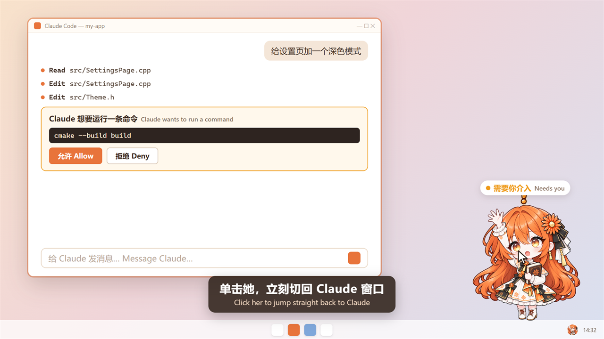

# ClauPet

[中文](#中文) | [English](#english)

https://github.com/user-attachments/assets/90fec8aa-7c5c-4e0a-9311-8e61b5b5b2b7

<p align="center">
  
</p>

<p align="center">
  
  
  
  
</p>

---

## 中文

ClauPet 是一个给 **Claude Code** 用的 Windows 桌面宠物。它浮在桌面上，通过 Claude Code 的 hooks 实时感知 Claude 的工作状态：Claude 在工作时，她捧着书认真阅读；Claude 需要你批准或者向你提问时，她举手提醒你；回复完毕时，她安静地微笑。

> 本项目是社区作品，与 Anthropic 无关。详见文末的[免责声明](#免责声明)。

### 功能

- **实时反映 Claude Code 的状态**：空闲、工作中、需要你介入、出错，共 4 种状态
- **支持多个会话同时工作**：一个会话结束了、另一个还在工作时，宠物不会错误地变回空闲
- **把鼠标放在宠物身上**：她会轻轻地上下浮动
- **单击宠物**：切换到 Claude 桌面应用的窗口
- **拖动宠物**：随意摆放，拖动时她会像被拎起后领一样悬在空中；下次启动时会出现在上次的位置
- **右键菜单 / 托盘图标**：隐藏、显示、退出
- 透明背景、无边框、始终置顶；在高分辨率屏幕上也能清晰显示

### 状态说明

| 状态 | 图片 | 什么时候出现 |
|---|---|---|
| 空闲 | 微笑，抱着书 | 程序刚启动、Claude 回复完毕（`Stop`） |
| 工作中 | 捧着打开的书 | 你发出消息（`UserPromptSubmit`）、Claude 调用工具（`PreToolUse` / `PostToolUse`） |
| 需要你介入 | 举手 + 感叹号 | Claude 申请权限（`PermissionRequest`），或者向你提问（`AskUserQuestion`） |
| 出错 | 流泪 | 因为 API 错误而中断（`StopFailure`） |

同时开着多个会话时，宠物显示其中**最需要关注**的那个状态，优先级为：**出错 > 需要你介入 > 工作中 > 空闲**。会话结束（`SessionEnd`）后，它的状态会被清除。

### 工作原理

```
Claude Code ── HTTP POST（hook 事件的 JSON）──▶ ClauPet（监听 127.0.0.1:52790）
```

Claude Code 的 [HTTP hooks](https://code.claude.com/docs/en/hooks) 会在发生特定事件时，把事件信息以 JSON 的形式 POST 到一个网址。ClauPet 在本机的 `127.0.0.1:52790` 上接收这些请求，读取其中的 `hook_event_name`、`session_id` 和 `tool_name`，据此切换状态。

ClauPet 没有运行时，hook 的请求会连接失败。Claude Code 把这种情况当作非阻塞错误处理，**不会影响 Claude 正常工作**。

### 系统要求

- Windows 10 / 11（64 位）
- Claude Code。已在 Claude 桌面应用的 Code 标签中测试；命令行版 Claude Code 使用同一套 hooks 机制，理论上同样可用，但尚未测试
- Microsoft Visual C++ 运行库（大多数电脑已经装有；如果启动时提示缺少 `MSVCP140.dll` 或 `VCRUNTIME140.dll`，请从[微软官网](https://learn.microsoft.com/cpp/windows/latest-supported-vc-redist)下载安装 x64 版本）

### 安装

**1. 下载并运行**

在 [Releases](../../releases) 页面下载最新的 zip，解压到任意文件夹，双击 `ClauPet.exe`。宠物会出现在桌面上，任务栏右下角会出现托盘图标。

**2. 配置 Claude Code 的 hooks**

打开（或新建）Claude Code 的用户设置文件：

```
%USERPROFILE%\.claude\settings.json
```

把下面的内容写进去。如果文件里已经有别的设置，只需要把 `"hooks"` 这一项加进去，注意 JSON 的逗号；如果已经有 `"hooks"`，就把下面各个事件合并进去。

```json
{
  "hooks": {
    "UserPromptSubmit": [
      { "hooks": [ { "type": "http", "url": "http://127.0.0.1:52790/", "timeout": 2 } ] }
    ],
    "PreToolUse": [
      { "hooks": [ { "type": "http", "url": "http://127.0.0.1:52790/", "timeout": 2 } ] }
    ],
    "PostToolUse": [
      { "hooks": [ { "type": "http", "url": "http://127.0.0.1:52790/", "timeout": 2 } ] }
    ],
    "PermissionRequest": [
      { "hooks": [ { "type": "http", "url": "http://127.0.0.1:52790/", "timeout": 2 } ] }
    ],
    "Stop": [
      { "hooks": [ { "type": "http", "url": "http://127.0.0.1:52790/", "timeout": 2 } ] }
    ],
    "StopFailure": [
      { "hooks": [ { "type": "http", "url": "http://127.0.0.1:52790/", "timeout": 2 } ] }
    ],
    "SessionEnd": [
      { "hooks": [ { "type": "http", "url": "http://127.0.0.1:52790/", "timeout": 2 } ] }
    ]
  }
}
```

`"timeout": 2` 表示每个请求最多等待 2 秒。万一 ClauPet 出现异常、收到请求却不回复，Claude 最多只会被拖慢 2 秒。

保存后即可生效，不需要重启 Claude Code。给 Claude 发一条消息，宠物就会开始工作。

**3. 开机自启（可选）**

按 `Win + R`，输入 `shell:startup` 并回车，把 `ClauPet.exe` 的快捷方式放进打开的文件夹。

### 使用

| 操作 | 效果 |
|---|---|
| 鼠标悬停在宠物身上 | 宠物轻轻地上下浮动 |
| 左键单击宠物 | 切换到 Claude 桌面应用的窗口（如果最小化了会先还原） |
| 左键拖动宠物 | 移动位置（拖动时会显示被拎起来的样子），松开时自动保存 |
| 右键宠物 / 右键托盘图标 | 菜单：隐藏或显示宠物、退出 |
| 先单击宠物，再按数字键 1–4 | 手动切换 4 种状态，用于测试 |

宠物隐藏后程序仍在后台运行，照常接收事件。退出程序请使用菜单里的退出项。

### 隐私与安全

- ClauPet 只监听 `127.0.0.1`（本机），其他电脑无法连接
- 它只读取事件中的 `hook_event_name`、`session_id` 和 `tool_name` 来判断状态，**不会保存、也不会向任何地方发送**你的对话内容
- 本地保存的唯一数据是宠物的位置，存放在注册表 `HKEY_CURRENT_USER\Software\ClauPet` 中

### 常见问题

**宠物一直不动？**
- 确认 `settings.json` 的格式正确，并且各个事件都在 `"hooks"` 下面同一层级
- 确认只运行了一个 ClauPet。同时运行两个时，只有先启动的那个能接收事件
- 确认 `52790` 端口没有被其他程序占用

**启动时提示缺少 DLL？**
请安装上面"系统要求"中提到的 Visual C++ 运行库。

### 从源码构建

需要：
- Visual Studio 2022 或更新版本，安装"使用 C++ 的桌面开发"工作负载
- Qt 6（已在 6.12.0 上测试），安装 **MSVC 2022 64-bit** 组件
- CMake 3.21 或更新版本（Visual Studio 自带）

步骤：
1. 克隆本仓库
2. 让 CMake 能找到 Qt：例如设置环境变量 `CMAKE_PREFIX_PATH` 为 `C:\Qt\6.12.0\msvc2022_64`（按你的安装路径修改），或者使用 Qt VS Tools 扩展
3. 在 Visual Studio 中通过"打开文件夹"打开项目，选择 Release 配置并生成，得到 `ClauPet.exe`
4. 打包依赖：

   ```
   windeployqt --release --no-translations ClauPet.exe
   ```

> 提示：在非英文版的 Windows / Visual Studio 中使用 Ninja 生成器时，CMake 可能无法正确识别编译器的 `/showIncludes` 输出，导致修改头文件后相关的 `.cpp` 不会重新编译。可以在 CMake 预设的 `environment` 中加入 `"VSLANG": "1033"`（并安装 Visual Studio 的英语语言包），让编译器输出英文。

### 路线图

ClauPet 还在持续开发中，接下来计划做的事情：

- **v1.1 更生动**：鼠标悬停时轻轻浮动；拖动时显示被拎起来的样子；用气泡文字显示 Claude 正在做什么
- **v1.2 整理架构**：把"接收事件"和"绘制宠物"拆开，为更换渲染方式做准备
- **长期**：支持 Live2D 模型
- **其他候选**：可自定义端口；托盘菜单里的"开机启动"开关；测试并支持命令行版 Claude Code

欢迎在 [Issues](../../issues) 里提建议。

### 许可

| 内容 | 许可 |
|---|---|
| 源代码 | [MIT License](LICENSE) |
| 角色图片（`assets/pet/`） | [CC BY-NC-SA 4.0](assets/pet/LICENSE)，**不可商用** |
| Qt（发布包中附带的 DLL） | [LGPL v3](https://www.qt.io/licensing/open-source-lgpl-obligations)，以动态链接方式使用 |

MIT 许可证**只适用于源代码**，不适用于角色图片。

### 致谢

- 角色原作：**ZipZipPipe** 的《Claude 拟人立绘·橘白礼服ver》（[来源](https://xn--pssy23gqgbz2d718b.com/works/claude202610030001.html)），采用 CC BY-NC-SA 4.0 许可。本项目中的 Q 版桌宠图片由 whywhy1352 以原作为参考、借助 AI 绘图工具创作，经原作者同意发布。感谢 ZipZipPipe 的授权！
- 使用 [Qt](https://www.qt.io/) 开发

### 免责声明

"Claude" 是 Anthropic, PBC 的商标。ClauPet 是独立的社区项目，与 Anthropic 无关，未获得 Anthropic 的认可或赞助。

---

## English

ClauPet is a Windows desktop pet for **Claude Code**. It floats on your desktop and reacts to what Claude is doing in real time through Claude Code hooks: she reads her book while Claude is working, raises her hand when Claude needs your approval or asks you a question, and smiles quietly when Claude has finished.

> This is a community project and is not affiliated with Anthropic. See the [Disclaimer](#disclaimer).

### Features

- **Reflects Claude Code's state in real time**: idle, working, needs your input, and error
- **Works with multiple sessions**: if one session finishes while another is still working, the pet keeps showing "working"
- **Hover over the pet** and she gently floats up and down
- **Click the pet** to bring the Claude desktop app's window to the front
- **Drag the pet** anywhere; she dangles as if lifted by her collar while you drag, and remembers her position across restarts
- **Right-click menu / tray icon**: hide, show, or quit
- Transparent, frameless, always on top, and crisp on high-DPI displays

### States

| State | Image | When |
|---|---|---|
| Idle | Smiling, holding a book | On startup, and when Claude finishes responding (`Stop`) |
| Working | Reading an open book | You send a message (`UserPromptSubmit`), Claude uses a tool (`PreToolUse` / `PostToolUse`) |
| Needs your input | Raised hand with an exclamation mark | Claude requests permission (`PermissionRequest`) or asks you a question (`AskUserQuestion`) |
| Error | Crying | The turn ended because of an API error (`StopFailure`) |

With several sessions open, the pet shows the state that **most needs your attention**, in this order: **error > needs your input > working > idle**. When a session ends (`SessionEnd`), its state is removed.

### How it works

```
Claude Code ── HTTP POST (hook event JSON) ──▶ ClauPet (listening on 127.0.0.1:52790)
```

Claude Code's [HTTP hooks](https://code.claude.com/docs/en/hooks) POST event data as JSON to a URL when certain events happen. ClauPet receives these requests on `127.0.0.1:52790`, reads `hook_event_name`, `session_id` and `tool_name`, and switches its state accordingly.

When ClauPet is not running, the hook requests simply fail to connect. Claude Code treats this as a non-blocking error, so **Claude keeps working normally**.

### Requirements

- Windows 10 / 11 (64-bit)
- Claude Code. Tested with the Code tab of the Claude desktop app; the Claude Code CLI uses the same hooks mechanism and should work too, but has not been tested yet
- Microsoft Visual C++ Redistributable (already present on most PCs; if you get an error about a missing `MSVCP140.dll` or `VCRUNTIME140.dll`, install the x64 version from [Microsoft](https://learn.microsoft.com/cpp/windows/latest-supported-vc-redist))

### Installation

**1. Download and run**

Download the latest zip from the [Releases](../../releases) page, extract it anywhere, and run `ClauPet.exe`. The pet appears on your desktop, along with an icon in the system tray.

**2. Configure Claude Code hooks**

Open (or create) your Claude Code user settings file:

```
%USERPROFILE%\.claude\settings.json
```

Add the following. If the file already contains other settings, add just the `"hooks"` entry (mind the JSON commas); if it already has `"hooks"`, merge these events into it.

```json
{
  "hooks": {
    "UserPromptSubmit": [
      { "hooks": [ { "type": "http", "url": "http://127.0.0.1:52790/", "timeout": 2 } ] }
    ],
    "PreToolUse": [
      { "hooks": [ { "type": "http", "url": "http://127.0.0.1:52790/", "timeout": 2 } ] }
    ],
    "PostToolUse": [
      { "hooks": [ { "type": "http", "url": "http://127.0.0.1:52790/", "timeout": 2 } ] }
    ],
    "PermissionRequest": [
      { "hooks": [ { "type": "http", "url": "http://127.0.0.1:52790/", "timeout": 2 } ] }
    ],
    "Stop": [
      { "hooks": [ { "type": "http", "url": "http://127.0.0.1:52790/", "timeout": 2 } ] }
    ],
    "StopFailure": [
      { "hooks": [ { "type": "http", "url": "http://127.0.0.1:52790/", "timeout": 2 } ] }
    ],
    "SessionEnd": [
      { "hooks": [ { "type": "http", "url": "http://127.0.0.1:52790/", "timeout": 2 } ] }
    ]
  }
}
```

`"timeout": 2` caps each request at 2 seconds, so even if ClauPet misbehaves and never replies, Claude is slowed down by at most 2 seconds.

The change takes effect as soon as you save; there is no need to restart Claude Code. Send Claude a message and the pet starts working.

**3. Start with Windows (optional)**

Press `Win + R`, type `shell:startup`, press Enter, and put a shortcut to `ClauPet.exe` in the folder that opens.

### Usage

| Action | Result |
|---|---|
| Hover over the pet | She gently floats up and down |
| Left-click the pet | Bring the Claude desktop app's window to the front (restoring it if minimized) |
| Left-drag the pet | Move it (she dangles as if lifted while dragged); the position is saved when you release the mouse |
| Right-click the pet or the tray icon | Menu: hide/show the pet, or quit |
| Click the pet, then press 1–4 | Switch between the four states manually, for testing |

When the pet is hidden, the program keeps running in the background and keeps receiving events. Use the menu to quit.

### Privacy and security

- ClauPet only listens on `127.0.0.1` (this computer); other machines cannot connect to it
- It only reads `hook_event_name`, `session_id` and `tool_name` from each event to decide its state. It **does not store or send** your conversation anywhere
- The only data it saves locally is the pet's position, in the registry under `HKEY_CURRENT_USER\Software\ClauPet`

### Troubleshooting

**The pet never changes state?**
- Check that `settings.json` is valid and that all events sit directly under `"hooks"`
- Make sure only one ClauPet is running. If two are running, only the first one receives events
- Make sure port `52790` is not used by another program

**A DLL is reported missing on startup?**
Install the Visual C++ Redistributable mentioned under Requirements.

### Building from source

You need:
- Visual Studio 2022 or later with the "Desktop development with C++" workload
- Qt 6 (tested with 6.12.0) with the **MSVC 2022 64-bit** component
- CMake 3.21 or later (included with Visual Studio)

Steps:
1. Clone this repository
2. Let CMake find Qt, for example by setting the `CMAKE_PREFIX_PATH` environment variable to `C:\Qt\6.12.0\msvc2022_64` (adjust to your installation), or by using the Qt VS Tools extension
3. Open the folder in Visual Studio ("Open Folder"), select the Release configuration, and build to get `ClauPet.exe`
4. Bundle the dependencies:

   ```
   windeployqt --release --no-translations ClauPet.exe
   ```

> Tip: With a non-English Windows or Visual Studio and the Ninja generator, CMake may fail to recognize the compiler's `/showIncludes` output, so editing a header does not rebuild the `.cpp` files that include it. Adding `"VSLANG": "1033"` to the `environment` of your CMake preset (and installing Visual Studio's English language pack) makes the compiler print English output and fixes this.

### Roadmap

ClauPet is under active development. Planned next steps:

- **v1.1 More lively**: a gentle float on hover; a "lifted" pose while dragged; a speech bubble showing what Claude is doing
- **v1.2 Refactoring**: separate event handling from rendering, to make other rendering methods possible
- **Long term**: Live2D model support
- **Other ideas**: configurable port; a "start with Windows" toggle in the tray menu; testing and supporting the Claude Code CLI

Suggestions are welcome in [Issues](../../issues).

### License

| Content | License |
|---|---|
| Source code | [MIT License](LICENSE) |
| Character artwork (`assets/pet/`) | [CC BY-NC-SA 4.0](assets/pet/LICENSE), **non-commercial** |
| Qt (DLLs bundled in the release) | [LGPL v3](https://www.qt.io/licensing/open-source-lgpl-obligations), used via dynamic linking |

The MIT License **applies to the source code only**, not to the character artwork.

### Credits

- Original character design: *《Claude 拟人立绘·橘白礼服ver》* by **ZipZipPipe** ([source](https://xn--pssy23gqgbz2d718b.com/works/claude202610030001.html)), licensed under CC BY-NC-SA 4.0. The chibi desktop-pet images in this project were created by whywhy1352 with AI image generation tools, using the original design as a reference, and are published with the author's permission. Many thanks to ZipZipPipe!
- Built with [Qt](https://www.qt.io/)

### Disclaimer

"Claude" is a trademark of Anthropic, PBC. ClauPet is an independent community project. It is not affiliated with, endorsed by, or sponsored by Anthropic.
